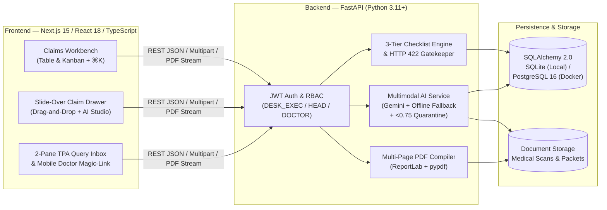

<div align="center">

# ClaimGuard

**Zero-Deduction Cashless Health-Insurance Claims & TPA Tracking Workspace**

[](https://github.com/Prakhar6947/ClaimGuard/actions)


[Architecture](#architecture) · [Core Engineering](#core-engineering-highlights) · [2-Minute Demo Walkthrough](#2-minute-reviewer-walkthrough) · [Quick Start](#quick-start) · [API Reference](#api-reference) · [Technical Design Doc](./TDD.md)

</div>

---

**ClaimGuard** is a full-stack operational workspace built for hospital insurance desks to coordinate cashless pre-authorisations, enhancement requests, TPA queries, and discharge packets across insurers and third-party administrators (TPAs).

Hospital insurance desks frequently lose revenue to avoidable missing-document deductions, slow manual email triage, and WhatsApp doctor chases that push discharge approvals past turnaround mandates. ClaimGuard replaces scattered spreadsheets and email threads with a **deterministic insurer × procedure checklist gatekeeper**, a **zero-trust human-in-the-loop AI extraction pipeline**, **isolated hospital-vs-TPA SLA timers**, and a **multi-page PDF dossier compiler**.

> **Prototype & Data Safety Notice:** ClaimGuard is an engineering demonstration built for evaluation and local development. It is not a certified medical, insurance, or regulatory-compliance system. Use only the included synthetic records and sample documents—never upload real patient data or production credentials.

---

## Core Engineering Highlights

| Capability | Engineering Implementation | Why It Matters |
| :--- | :--- | :--- |
| **3-Tier Checklist Rule Engine** | Computes required documents via specificity inheritance: `Universal Rules ∪ Insurer Rules ∪ (Insurer × Procedure) Rules`, materialized onto each claim without clobbering verified uploads. | Admins maintain universal KYC rules once while overriding procedure-specific mandates (e.g., Ultrasound for cholecystectomy, serial platelets for dengue). |
| **Submission Gatekeeper (`HTTP 422`)** | Backend state machine blocks transitions (`PREAUTH_SENT`, `APPROVED`, `FINAL_BILL`, `SETTLED`) and TPA query replies whenever mandatory slots are missing or AI fields remain unconfirmed. | Prevents incomplete claim packets from leaving the desk unless explicitly waived by a `DESK_HEAD` with an audited justification. |
| **Zero-Trust AI + Failure Recovery** | Uses **Google Gemini** (with a deterministic offline fallback) to classify scans and extract pre-auth fields with **verbatim source snippets**. Uploads scoring below `0.75` confidence route to a **Manual Quarantine Tray**. | Nothing is auto-committed or auto-sent. Staff confirm/edit every extracted field beside its source quote and **drag-and-drop** misfiled scans onto the right checklist slot. |
| **Multi-Page PDF Dossier Merger** | Generates a structured hospital cover sheet & verification index via **ReportLab** (`Paragraph`-wrapped tables for zero overlap) and merges verified diagnostic PDFs in checklist sequence via **pypdf**. | Compiles an insurer-ready multi-page submission dossier in under 150 ms without headless browser overhead. |
| **RBAC & Privacy Audit Trail** | Role-scoped permissions across `DESK_EXEC`, `DESK_HEAD`, and `DOCTOR`. Policy numbers are masked by default (`XXXX-XXXX-3381`), and revealing them logs an immutable `DPDP_PII_POLICY_UNMASKED` audit event. | Enforces least privilege (`HTTP 403` on unauthorized waivers/rule edits) and full accountability across all state transitions. |
| **Operational Clinical UI** | Fixed sidebar workspace (collapsing to a mobile slide-over drawer), **Table ⇄ Kanban** views, live tabular-monospace SLA timers, 2-pane master-detail Query Inbox, `⌘K` command palette, and a 360px mobile Doctor Magic-Link view. | Surfaces missing-document gaps and ticking SLA countdowns immediately without digging through nested screens. |

---

## Architecture



---

## AI Safeguards & Human-in-the-Loop Design

| Failure Mode | System Guardrail |
| :--- | :--- |
| **Blurry / Ambiguous Scan (`confidence < 0.75`)** | Automatically quarantined (`needs_manual_sorting = True`); never auto-fills a mandatory slot. |
| **Misclassified Document** | Drag-and-drop the document onto the correct checklist row (or use the slot dropdown) — logs `AI_SLOT_CORRECTED_BY_HUMAN`. |
| **OCR Hallucination / Misread Value** | Every pre-filled field starts as `PENDING` with its verbatim source quote and page number; requires explicit human click to **Confirm** or **Edit**. |
| **Incomplete TPA Query Summary** | The unmodified original verbatim TPA email is always rendered below the AI summary; replies are never sent automatically. |
| **Missing API Key / LLM Outage** | Seamlessly degrades to a deterministic local analyzer so workflows and evaluations remain 100% functional offline. |

---

## 2-Minute Reviewer Walkthrough

Once running locally (or via Docker Compose), you can test every core flow in two minutes using the seeded synthetic dataset and the bottom-right **Reviewer Demo Toolkit**:

1. **Sign In & Explore the Queue:** Log in as Desk Executive (`demo.exec@example.invalid` / `ClaimGuard@2026`). Toggle between **Table View** and **Kanban Board**, or press `⌘K` / `Ctrl+K` to jump to any claim.
2. **Create an Admission:** Select **New Admission**, enter synthetic patient and policy details, and submit. The API validates the input, records the acting role, and creates the claim with its insurer/procedure-specific checklist.
3. **Trigger the Submission Gatekeeper (`HTTP 422`):** Open a claim with a missing mandatory document and click **Verify & Dispatch Pre-Auth Packet**. Observe the backend rejecting the transition with the exact missing slots and unconfirmed AI fields.
4. **Test Multimodal Upload & Source Citations:** Click the quick-inject sample report button inside the claim drawer (or upload one of the generated PDFs in `backend/storage/`). Open the **AI Verification Studio** tab to inspect the extracted values next to their verbatim source snippets, then click **Confirm Field**.
5. **Test the AI Failure Fallback (`< 75%` Confidence):** Inject the sample blurry scan. Because confidence is below `0.75`, it lands in the amber **Low-Confidence Quarantine Tray**. **Drag and drop** the card directly onto any checklist row to reassign it.
6. **Inspect the Multi-Page Merged PDF Dossier:** Switch to the **Merged TPA Packet Preview** tab to view the live compiled cover sheet + appended scan PDFs inline, or download the file directly.
7. **Test RBAC, Query Inbox & Doctor Mobile View:**
   - Open **TPA Query Inbox** to review AI-summarized queries above their verbatim emails, or simulate a live inbound query webhook from the **Reviewer Demo Toolkit**.
   - Click **Open Doctor Mobile Link** to test the 360px ward-round clinical justification sign-off.
   - Switch to Desk Head (`demo.head@example.invalid`) to add a new rule in **Insurer Rule Matrix** or waive a mandatory slot, then inspect the **DPDP Security Audit Log**.

---

## Tech Stack

| Layer | Technologies |
| :--- | :--- |
| **Frontend** | Next.js 15 (App Router), React 18, TypeScript, Tailwind CSS, Lucide Icons |
| **Backend** | Python 3.11+, FastAPI, Pydantic v2, SQLAlchemy 2.0, Uvicorn |
| **Auth & Security** | JWT (`python-jose`), bcrypt password hashing, Role-Based Access Control, PII Masking & Audit Logging |
| **Database** | SQLite (zero-config local dev) · PostgreSQL 16 (Docker Compose & production) |
| **PDF & AI** | ReportLab, pypdf, Google Gemini SDK (`google-genai`) with deterministic local fallback |
| **Testing & CI** | pytest, httpx, GitHub Actions CI (backend test suite + strict Next.js production build) |

---

## Quick Start

### Option A: Docker Compose (Recommended — PostgreSQL 16 + API + Frontend)

```bash
git clone https://github.com/Prakhar6947/ClaimGuard.git
cd ClaimGuard
docker compose up --build
```

- **Web Workspace:** `http://localhost:3000`
- **API & Swagger Docs:** `http://localhost:8000/docs`
- Stop and clean up containers with `docker compose down`.

### Option B: Manual Local Setup (Zero-Config SQLite)

**Prerequisites:** Python 3.11+ and Node.js 20+

#### 1. Start the FastAPI Backend

```bash
cd backend
python3 -m venv .venv
source .venv/bin/activate        # Windows: .venv\Scripts\activate
python -m pip install -r requirements.txt
cp .env.example .env

# Load environment variables into the current shell
set -a
source .env
set +a

# Seed synthetic claims, rules, demo accounts, and sample PDFs
python -m app.seed

# Run the API server
uvicorn app.main:app --reload --host 127.0.0.1 --port 8000
```

#### 2. Start the Next.js Frontend

In a second terminal:

```bash
cd frontend
npm ci
cp .env.example .env.local
npm run dev
```

Open `http://localhost:3000`.

---

## Demo Accounts

The seed script creates local-only demo accounts with the shared password `ClaimGuard@2026`:

| Role | Email | Permissions |
| :--- | :--- | :--- |
| **Desk Executive (`DESK_EXEC`)** | `demo.exec@example.invalid` | Queue management, new admissions, scan uploads, AI field confirmation, slot reassignment, query replies, PDF exports |
| **Desk Head (`DESK_HEAD`)** | `demo.head@example.invalid` | All executive actions + insurer × procedure rule creation, mandatory slot waivers, CFO analytics & audit log review |
| **Treating Doctor (`DOCTOR`)** | `demo.doctor@example.invalid` | Mobile clinical justification sign-off via claim-scoped magic link |

> Replace demo credentials and set a unique `JWT_SECRET_KEY` before exposing any non-local environment.

---

## API Reference

<details>
<summary><strong>Click to expand core REST endpoints</strong> (Full interactive OpenAPI docs at <code>/docs</code>)</summary>

| Method | Endpoint | Description |
| :--- | :--- | :--- |
| `GET` | `/api/v1/health` | Return API health status |
| `POST` | `/api/v1/auth/login` | Authenticate staff user and return JWT bearer token |
| `GET` | `/api/v1/claims` | List claims with computed gap summaries, SLA timers, and KPIs |
| `POST` | `/api/v1/claims` | Validate a new admission, record the acting role, and materialize its 3-tier checklist |
| `GET` | `/api/v1/claims/{id}` | Retrieve full claim dossier, checklist slots, AI fields, queries, and timeline |
| `POST` | `/api/v1/claims/{id}/documents/upload` | Upload scan, run AI slot classification & field extraction (with `<0.75` quarantine) |
| `GET` | `/api/v1/sample-docs/{file_name}` | Download a synthetic sample document for local testing |
| `POST` | `/api/v1/claims/{id}/documents/{doc_id}/reassign` | Move a quarantined or misfiled document to a target checklist slot |
| `POST` | `/api/v1/claims/{id}/fields/{field_id}/confirm` | Human confirmation or inline edit of an AI-extracted field |
| `POST` | `/api/v1/claims/{id}/checklist/{item_id}/waive` | `DESK_HEAD`-only mandatory slot waiver with audited justification |
| `POST` | `/api/v1/claims/{id}/transition` | Advance claim lifecycle stage (enforces `HTTP 422` Submission Gatekeeper) |
| `GET` | `/api/v1/claims/{id}/packet.pdf` | Compile and stream/download multi-page merged TPA PDF dossier (`?inline=true` supported) |
| `POST` | `/api/v1/claims/{id}/audit-unmask` | Record immutable audit event when a masked policy number is revealed |
| `POST` | `/api/v1/queries/{id}/reply` | Dispatch human-reviewed TPA query response (gatekept) |
| `POST` | `/api/v1/webhooks/simulate-tpa-query/{id}` | Simulate inbound TPA query email webhook for live triage testing |
| `POST` | `/api/v1/doctor/magic-link/{query_id}/sign` | Record treating doctor's mobile clinical justification sign-off |
| `GET` / `POST` | `/api/v1/rules` | Inspect or add (`DESK_HEAD`) insurer × procedure checklist rules |
| `GET` | `/api/v1/audit-logs` | Retrieve append-only security and verification audit trail |

</details>

### New admission request

`POST /api/v1/claims` accepts JSON. Use synthetic values only. Patient age must be between 1 and 119, the policy number must contain at least 6 characters, and the estimated amount must be positive. The acting user and role are recorded with the admission.

```json
{
  "patient_name": "Demo Patient",
  "patient_age": 48,
  "patient_gender": "M",
  "uhid": "DEMO-UHID-9412",
  "ward_bed": "Ward A / Bed 06",
  "policy_number_full": "DEMO-POLICY-492810",
  "insurer_id": "INS-COMP-B",
  "procedure_id": "PROC-GALL",
  "treating_doctor_name": "Dr. Demo One",
  "estimated_amount_inr": 82000,
  "actor_name": "Demo Executive",
  "actor_role": "DESK_EXEC"
}
```

---

## Configuration

See `backend/.env.example` and `frontend/.env.example`. The repository includes development-only demo credentials and fallback signing-key values; never expose them in a deployed environment. Configure unique production secrets outside version control.

| Variable | Component | Purpose |
| :--- | :--- | :--- |
| `DATABASE_URL` | Backend | SQLAlchemy connection string (defaults to local SQLite; PostgreSQL 16 in Docker) |
| `JWT_SECRET_KEY` | Backend | Signing key for HS256 JWT tokens (set a strong unique value in non-local envs) |
| `ACCESS_TOKEN_EXPIRE_MINUTES` | Backend | Access token lifetime in minutes |
| `AI_CONFIDENCE_THRESHOLD` | Backend | Minimum confidence (`0.75`) to auto-slot uploads; lower scores route to manual quarantine |
| `GEMINI_API_KEY` | Backend | Optional Google Gemini API key (uses deterministic fallback when unset) |
| `GEMINI_MODEL_NAME` | Backend | Gemini model identifier (e.g., `gemini-2.5-flash`) |
| `CORS_ALLOWED_ORIGINS` | Backend | Comma-separated list of allowed browser origins |
| `NEXT_PUBLIC_API_BASE_URL` | Frontend | Base URL of the FastAPI backend |
| `NEXT_PUBLIC_ENABLE_DEMO_TOOLKIT` | Frontend | Toggles the floating Reviewer Demo Toolkit drawer |

---

## Tests & Continuous Integration

GitHub Actions (`.github/workflows/ci.yml`) runs both the backend pytest suite and strict frontend TypeScript/Next.js production build on every push and pull request.

```bash
# Backend automated test suite (Rule engine, HTTP 422 gatekeeper, RBAC 403, AI quarantine, PDF merger, PII audit)
cd backend
source .venv/bin/activate
pytest tests -v

# Frontend type-check, lint, and production build
cd frontend
npm ci
npm run build
```

---

## Repository Layout

```text
ClaimGuard/
├── .github/workflows/ci.yml     # Automated Pytest + Next.js production build CI
├── docker-compose.yml           # PostgreSQL 16 + FastAPI + Next.js 15 local stack
├── TDD.md                       # Architecture, data model, assumptions & trade-offs
├── deployment.md                # Local runbook, cloud deployment & env reference
├── backend/
│   ├── app/
│   │   ├── main.py              # FastAPI routes & API endpoints
│   │   ├── models.py            # SQLAlchemy 2.0 relational schema (10 tables)
│   │   ├── schemas.py           # Pydantic v2 validation schemas
│   │   ├── auth.py              # JWT auth & RBAC guards
│   │   ├── seed.py              # Synthetic dataset & sample diagnostic PDF generator
│   │   └── services/
│   │       ├── rule_engine.py   # 3-tier checklist specificity resolver & gatekeeper
│   │       ├── ai_service.py    # Gemini multimodal extractor + deterministic fallback
│   │       └── pdf_packet.py    # ReportLab cover dossier + pypdf attachment merger
│   ├── storage/                 # Local uploads & generated PDFs (gitignored)
│   └── tests/                   # Automated pytest integration & unit tests
└── frontend/
    └── src/
        ├── app/                 # Next.js 15 App Router entry, layout & clinical styles
        ├── components/          # Workbench, slide-over drawer, query inbox, analytics & mobile view
        └── lib/                 # Typed API client & domain contracts
```

---

## Documentation & Privacy

- **Technical Design Document ([`TDD.md`](./TDD.md))** — Architecture rationale, ERD, explicitly labeled assumptions, AI failure modes, and scope trade-offs.
- **Deployment & Operations Guide ([`deployment.md`](./deployment.md))** — Step-by-step local, Docker, and cloud deployment instructions.

Keep `.env` files, local SQLite databases, uploaded scans, and production credentials out of version control. Demo credentials and Compose defaults are for local evaluation only; replace them before exposing any instance. Local runtime state is excluded by `.gitignore`.
